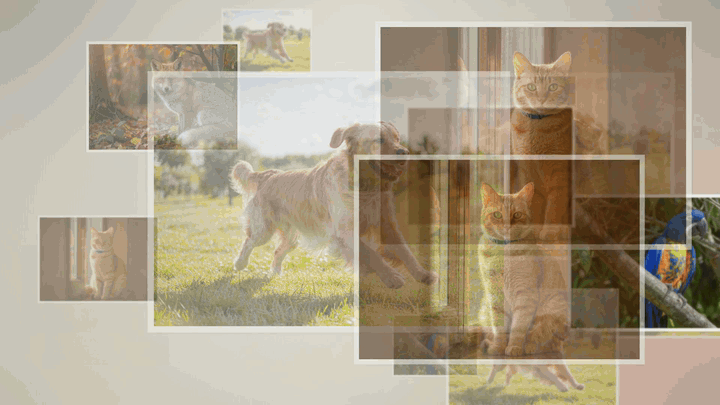

# 年会爱心墙

照片从四面八方飘来，逐张特写，最后聚成一颗心 —— 一条 40 秒左右的年会暖场/收尾片。


<!-- ↑ 首屏演示 GIF：43 张照片汇聚成心 + 心形定格 + 结语淡入
     （720×405 / 8fps / 14 秒 / 4.8MB，取自成片 46–60 秒尾段）。
     完整流程是「3D 漂浮 → 逐张特写（一张不漏）→ 汇聚成心」，
     GIF 只截最高潮的汇聚段，方便别人快速看到最终效果。
     素材是 demo/gif-source/ 里 4 张 AI 生成的动物图随机铺成 43 张
     （已裁掉 AI 水印），来源见 demo/CREDITS.md。

     想重新生成（命令可复现，出来的就是这个 GIF）：
       for n in $(seq 1 43); do cp demo/gif-source/动物_0$((RANDOM%4+1)).jpg photos/动物_$(printf %02d $n).jpg; done
       启动服务，然后：
       node tools/export-video.mjs --out output/demo.mp4 --hold 4
       ffmpeg -ss 46 -t 14 -i output/demo.mp4 \
              -vf "fps=8,scale=720:-1:flags=lanczos,palettegen=stats_mode=diff" palette.png
       ffmpeg -ss 46 -t 14 -i output/demo.mp4 -i palette.png \
              -filter_complex "fps=8,scale=720:-1:flags=lanczos[x];[x][1:v]paletteuse=dither=none" \
              -loop 0 docs/demo.gif
     注：palettegen 生成专用调色板是消除渐变背景色带的关键，
         直接 scale 转 GIF 会在背景上留一层噪点纹路。 -->

- **零依赖、零构建**：只用 Node 自带的 `http`，前端是原生 ES Module，没有 `npm install`，没有打包器。
- **双击即用**：Mac 双击 `start.command`，Windows 双击 `start.bat`，Linux 跑 `./start.sh`。
- **现场友好**：所有写盘都是「先写临时文件再原子替换」，断电也不会留下半截 JSON。

## 快速开始

1. 装一次 [Node.js](https://nodejs.org)（点绿色 LTS 按钮，一路继续）
2. 把照片丢进 `photos/`，想放背景音乐就丢一首 mp3 进 `music/`
3. 双击启动脚本，浏览器会自动打开

| 系统 | 怎么启动 |
| --- | --- |
| macOS | 双击 `start.command` |
| Windows | 双击 `start.bat` |
| Linux | 终端里 `./start.sh` |

更详细的现场操作说明（上传、排序、改文案、调节奏、导 MP4、常见问题）看
[**使用说明.txt**](使用说明.txt)。

## 三个入口

| 命令 | 作用 |
| --- | --- |
| `node start.js` | 跨平台启动器：探系统、选端口、开浏览器 |
| `node server.js` | 只起服务，不开浏览器（配 `NO_OPEN=1`） |
| `node tools/export-video.mjs` | 逐帧录制成 MP4（需要 Chrome + ffmpeg） |

常用环境变量：

| 变量 | 说明 |
| --- | --- |
| `PORT` | 起始端口，默认 `8787`，被占用自动顺延到 `8797` |
| `NO_OPEN=1` | 启动后不自动打开浏览器 |
| `NO_START_PAUSE=1` | 启动器出错时不等按键直接退出（自动化用） |
| `HEARTWALL_ROOT` | 把项目根目录指到别处（**仅测试用**，平时不要设） |

## 目录结构

```
爱心墙/
├── start.js              跨平台启动器（三平台的启动脚本都调它）
├── start.command         macOS 双击启动
├── start.bat             Windows 双击启动
├── start.sh              Linux 启动
├── server.js             服务端：9 个接口 + 静态资源 + 插件加载
├── config.json           所有设置（文案 / 节奏 / 音乐），自动生成，可手改
├── public/
│   ├── heart.js          心形排版内核（纯函数，零 DOM，有单元测试）
│   ├── player.*          播放页（漂浮 → 特写 → 汇聚 → 结语）
│   └── admin.*           管理台（上传 / 排序 / 设置 / 预览）
├── photos/               照片 + manifest.json（顺序索引，自动维护）
├── music/                背景音乐
├── output/               导出的 MP4
├── logs/                 运行日志（一天一份）
├── addons/               扩展插件，见 addons/README.md
├── tools/                导出工具
├── tests/                自动化测试
└── docs/                 设计文档（架构 / 时序 / 视觉规格）
```

## 跑测试

```bash
node --test
```

- `tests/heart.test.mjs` —— 心形排版内核（几何、行数、面积守恒、极端参数）
- `tests/api.test.mjs` —— 服务端接口（上传 / 排序 / 删除 / 配置校验 / 路径穿越防护）
- `tests/export.test.mjs` —— 导出工具的参数解析与时间轴推导（不跑真 ffmpeg）

测试全部在临时目录里跑，**不会碰你 `photos/` 里的照片**。

## 扩展插件

想把心形换成别的形状？不用改核心代码：把插件文件夹拷进 `addons/` 重启即可。
协议与最小示例见 [addons/README.md](addons/README.md)。

## 浏览器要求

Chrome / Edge / Safari 近两年的版本都可以。
播放页第一次需要点一下画面才会出声 —— 这是浏览器的规定，不是故障。

## 许可证

**BSL 1.1**（Business Source License）

- 个人学习、内部使用、非商业场景：免费，随便改、随便分发
- 商业用途（企业活动、商业宣传、收费代做、再销售）：需要商业授权
- **你导出的视频归你所有**，可以自由商用 —— 不用担心「我做的片算谁的」
- **2030-10-23 起自动转为 Apache-2.0**（标准开源协议）

完整条款见 [LICENSE](LICENSE)。商业授权请联系仓库维护者。

| 想做什么 | 要不要授权 |
| --- | --- |
| 自己公司年会放一放 | 不要 |
| 学习、改代码、发给朋友 | 不要 |
| 用它接单做商业片 | 要 |
| 把成品拿去卖 | 要 |
