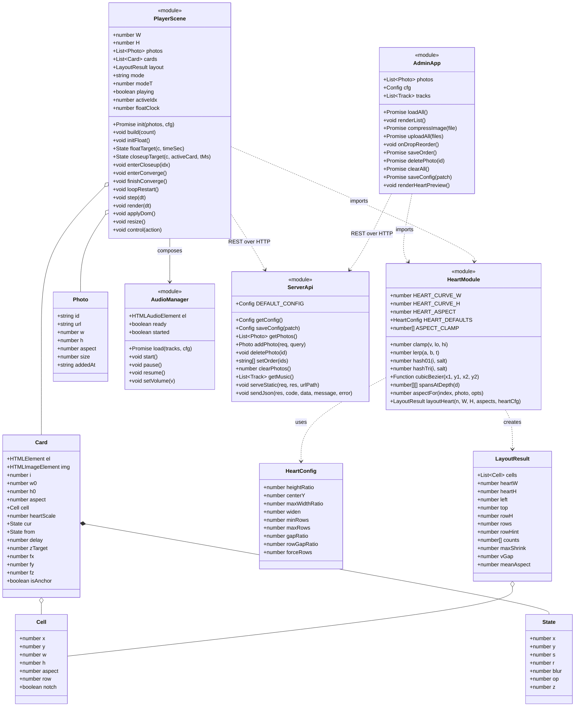
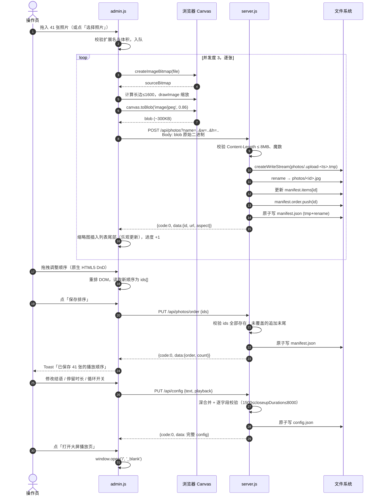
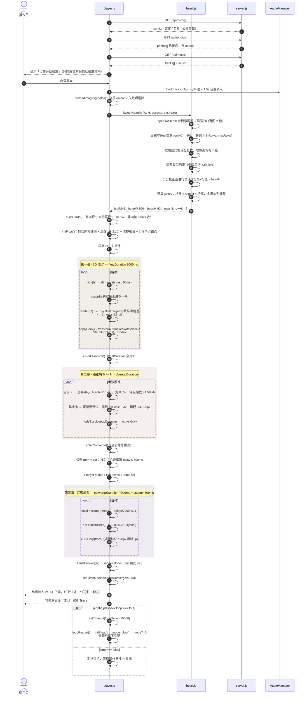
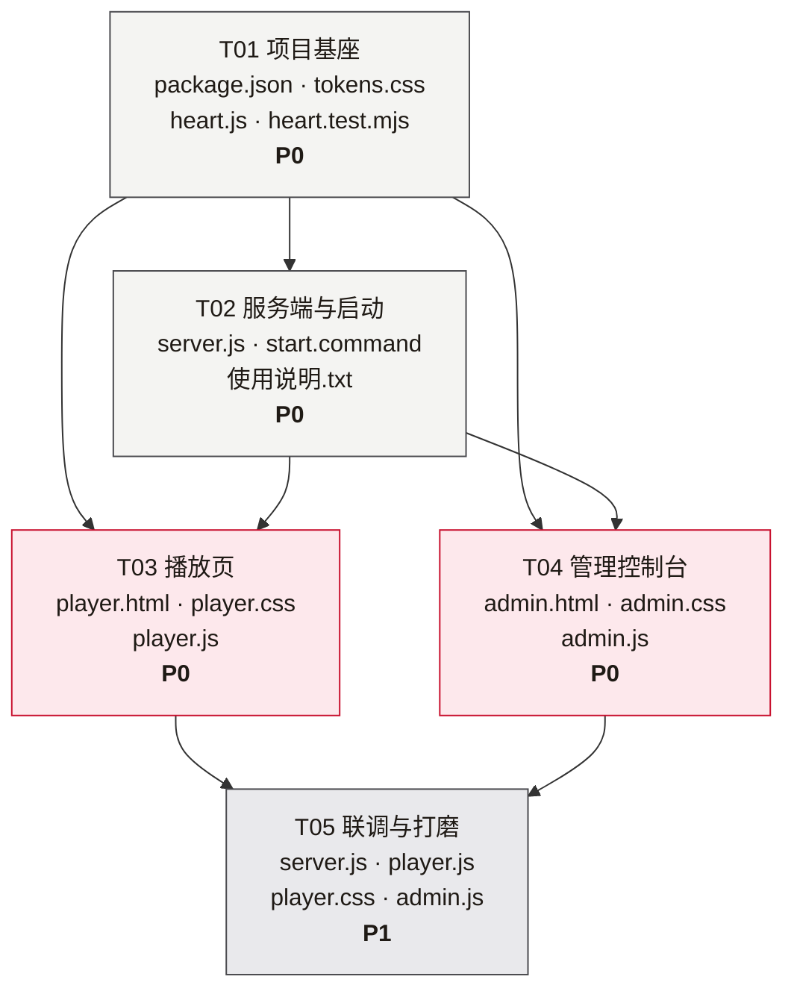

# 年会爱心墙 · 系统架构设计

> 版本：v1.0 · 架构师：高见远
> 依据：`prototype/index.html`（已验收原型，1795 行）+ `docs/visual-spec.md`（逐像素实测规格）
> 本文档目标：工程师可以**逐节照着写代码**，不需要再做设计决策。

---

## 1. 实现方案与选型理由

### 1.1 核心难点拆解

| 难点 | 本质 | 对策 |
|---|---|---|
| 41–100 张照片每帧独立变换 + 独立模糊 | 60fps 下 100 个图层的合成 | DOM 元素 + `transform`/`filter`，交给合成器 |
| 心形 justify 排布 | 参数方程求横带区间 + 面积守恒定行数 | 纯函数 `layoutHeart`，无 DOM 依赖 |
| 三幕动线的连续状态机 | 阶段推进 + 目标值插值 + 缓动 | `Scene` 单状态机 + rAF 循环（原型已实现，原样继承） |
| 无构建、无 npm | 服务端与前端都要"零依赖" | Node 内置 `http`/`fs`/`path`；前端原生 ES Module |
| 大图拖慢大屏 | 手机原图 4–8MB，41 张解码爆内存 | 上传前浏览器 canvas 降采样到 1600px 长边 |
| 无人值守整晚运行 | 断电/写配置中断必须不损坏文件 | 所有写盘走 `.tmp` + `fs.renameSync` 原子替换 |

### 1.2 为什么用 DOM + CSS transform，而不是 Canvas

**结论：DOM。** 四个硬理由：

1. **逐元素高斯模糊在 Canvas 上代价高。** 需求要求每张照片按景深有**不同的** `blur(0~6px)`（`visual-spec.md §4.1`）。DOM 的 `filter: blur()` 由合成器在 GPU 上对已栅格化的图层做，一次提交、零主线程开销；Canvas 方案必须 `ctx.filter = 'blur(Npx)'` 逐张 `drawImage`，每帧 100 次带模糊的绘制在 4K 分辨率下会掉到 20fps 以下；若改用离屏预模糊，则 100 张 × 多级模糊的离屏画布内存不可接受。
2. **transform 不触发 layout/paint。** `.card { will-change: transform, filter, opacity }` 让每张卡独立成合成层，改 `transform` 只是图层矩阵变更，主线程几乎零成本。Canvas 每次 `clearRect + 全量重绘`。
3. **图片解码由浏览器托管。** `` 的解码、缓存、渐进渲染、`naturalWidth` 探测全部免费；Canvas 需自己 `new Image()` + `drawImage`，还要管解码时机。
4. **结语文字是中文书法字体。** DOM 直接吃到 `STKaiti`/`KaiTi` 系统字体与 `text-shadow`；Canvas 要自己量宽、排版、处理 webfont 加载。

**原型已验证这条路线在 59 张下流畅**（`prototype/index.html` 实跑通过），本次只是把张数上限提到 100 并加上管理侧，不换渲染路径。

**Canvas 只在管理台用一个场景**：心形布局预览图。那里只需画 100 个彩色矩形、尺寸小、静态不刷新，Canvas 更省 DOM。

**DOM 路线的风险与对策：**
- 100 个合成层 × 4K → 显存吃紧。对策：卡片**基准尺寸取"特写尺寸"**（`0.5 × 画面宽`，最多 960 CSS px @1920 逻辑宽），而不是按心形小格子建卡再放大——这样栅格化上限可控，且不会因为"小图放大"而糊（原型 §build 注释已说明此点）。
- 上传图统一压到 **1600px 长边**，解码后单张 ≈ 7–10MB，41 张 ≈ 300–400MB，可控。

### 1.3 为什么不用 `multipart/form-data`

手写 multipart 解析器在纯 Node `http` 下没有第三方库（`busboy`/`formidable`）时，需要正确处理：

- boundary 提取与分段（boundary 可能出现在二进制内容中，需按 CRLF 前缀匹配）
- 跨 chunk 的 boundary 拼接（boundary 会被 TCP 分片切断）
- `Content-Disposition` 里的 `filename*` RFC 5987 编码（中文文件名）
- 尾部 `\r\n--boundary--\r\n` 收尾判定
- 与 `Content-Length` 的配合、流式背压

任一环节出错都是**静默的文件损坏**，且极难在 41 张批量上传时定位。**代价与收益完全不成正比。**

**采用方案：原始二进制直传。**

```js
// 前端
await fetch(`/api/photos?name=${encodeURIComponent(name)}&w=${w}&h=${h}`, {
  method: 'POST',
  headers: { 'Content-Type': 'image/jpeg' },
  body: blob,           // Blob 直接作为 body，浏览器负责流式发送
});
```

```js
// 服务端：req 就是一个纯二进制流
const ws = fs.createWriteStream(tmpPath);
req.pipe(ws);           // 零解析、零内存堆积、天然背压
ws.on('finish', () => { fs.renameSync(tmpPath, finalPath); });
```

文件名与长宽走 query（短、ASCII 安全），图片内容走 body。**解析代码量为 0。**

（另一个候选是 base64 JSON，但因为体积 +33%、且必须整包驻留内存，直接排除。）

### 1.4 客户端上传前压缩策略

没有 `sharp` / `jimp`（服务端零依赖），也没有构建工具引入前端图像库。**用浏览器自己降采样**——这是零成本、最高质量的方案：

```
File ──createImageBitmap()──▶ 源位图
     ──计算目标尺寸（长边 ≤ 1600）──▶
     ──OffscreenCanvas / <canvas> 双线性缩放──▶
     ──canvas.toBlob('image/jpeg', 0.86)──▶ Blob（150–400KB）
     ──POST 原始二进制──▶ server
```

要点：

| 项 | 值 | 理由 |
|---|---|---|
| 长边上限 | **1600 px** | 4K 屏（dpr=2，逻辑宽 1920）下特写卡最大 960 CSS px = 1920 设备 px；1600 上采样 1.2×，大屏 5m 外观看无差别 |
| 输出格式 | **JPEG q=0.86** | 所有上游格式（HEIC/PNG/WebP）统一落成 JPEG，服务端只需一套 MIME |
| 缩放算法 | `drawImage` 双线性（默认） | 关闭 `imageSmoothingQuality='high'` 会更快但边缘锯齿；这里开 `high`，41 张压缩总耗时 < 3s |
| 并发 | **3** | 太高会挤占主线程造成 UI 卡顿 |
| 已小于 1600px 的图 | 仍重新编码（q=0.92） | 统一格式，避免 HEIC 无法在浏览器 `` 直接显示 |
| 失败兜底 | 压缩失败则上传原文件 | 宁可有张 HEIC 显示不出来，也不要整批上传中断 |

**压缩不仅为了传输，更是为了大屏渲染**：41 张 4MB 原图 = 164MB 网络 + 数 GB 解码位图，会直接把 4K 大屏的合成器拖垮。

### 1.5 整体架构模式

- **服务端**：单进程、单文件、无框架的 **REST + 静态资源** 服务。无状态，所有状态落在 `config.json` 与 `photos/manifest.json` 两个 JSON 文件上。单操作员使用，**不需要并发控制 / 锁 / 事务**。
- **前端**：两个独立 HTML 页面（播放页 / 管理台），**共享一个纯计算模块** `heart.js`。没有路由、没有组件框架，页面级脚本各自管好自己的 DOM。
- **模块风格**：原生 **ES Module**（`import`/`export`）。为此加一个只有 `"type": "module"`、**零依赖** 的 `package.json`——**不需要也不允许 `npm install`**，它只是让 Node 与浏览器用同一套模块语义，并让 `tests/heart.test.mjs` 能直接 import 生产代码做验收。

---

## 2. 文件清单

```
爱心墙/
├── package.json                声明 type:module（零依赖，不装 npm）
├── server.js                   Node 原生 http：静态资源 + REST API + 启动开浏览器
├── start.command               双击启动脚本（chmod +x）
├── config.json                 ★用户可编辑设置（首次运行自动生成，可手改）
├── 使用说明.txt                 非技术操作员的一页纸说明
├── tests/
│   └── heart.test.mjs          心形算法的零框架断言脚本（node tests/heart.test.mjs）
├── public/
│   ├── tokens.css              设计令牌：色板 / 字体栈 / 重置（player 与 admin 共用）
│   ├── heart.js                ★纯计算：心形曲线、区间求解、justify 排布、宽高比、缓动
│   ├── player.html             播放页（大屏全屏）
│   ├── player.css              播放页样式（原型 <style> 逐条移植）
│   ├── player.js               播放引擎：三幕状态机 + rAF 渲染 + 音频 + 循环
│   ├── admin.html              管理控制台
│   ├── admin.css               管理台样式
│   └── admin.js                控制台逻辑：上传 / 拖拽排序 / 删除 / 配置 / 预览
├── photos/
│   ├── manifest.json           照片索引：顺序 + 尺寸 + 时间（程序维护，勿手改）
│   └── <id>.jpg                照片文件，文件名即 id
└── music/
    └── (放任意 mp3/m4a/wav/ogg)
```

**共 15 个文件（含 1 个自动生成的 config.json 与 1 个自动生成的 manifest.json）。**

### 与任务书建议清单的差异及理由

| 建议 | 实际 | 理由 |
|---|---|---|
| `public/style.css` 一份共用 | 拆成 `tokens.css` + `player.css` + `admin.css` | 播放页样式是原型 `<style>` 的**逐条移植**（大量 `calc(var(--w)*…)`），必须保持"一个字不改"以免动效走样；管理台是完全不同的应用外壳。硬塞一个文件会让两边互相污染。真正共用的只有色板与字体，抽成 `tokens.css`。 |
| 无 `package.json` | 加一个零依赖 `package.json` | 让 `heart.js` 用原生 ESM 被浏览器和 Node 测试同时 import。**不执行 npm install，无 node_modules**。 |
| 无测试 | 加 `tests/heart.test.mjs` | 心形算法是全项目唯一"算错了肉眼不易发现"的部分（行数、尖底收口、铺满率）。零框架 30 行断言，`node tests/heart.test.mjs` 即跑，是 T01 的硬验收门。 |
| 无说明文档 | 加 `使用说明.txt` | 现场是行政/HR 操作，不是工程师。双击什么、照片放哪、怎么换文案，写在一页纸里。 |
| 照片元数据无归属 | 加 `photos/manifest.json` | 顺序与尺寸必须持久化。放进 `config.json` 会让"用户手改的文案"和"程序写的索引"混在一起，一旦格式化就全丢。分开存：`config.json` 给人改，`manifest.json` 给程序写。 |
| `public/index.html` | **不要** | 服务端把 `/` 直接映射到 `player.html`，少一个跳转文件。 |

---

## 3. 接口设计

**统一响应信封**（所有 `/api/*`，无一例外）：

```json
{ "code": 0, "data": {}, "message": "ok" }
```

失败时 `code` 非 0，同时带机器可读的 `error`：

```json
{ "code": 400, "data": null, "message": "照片数量已达上限 200", "error": "TOO_MANY_PHOTOS" }
```

| code | 含义 | error 取值 |
|---|---|---|
| 0 | 成功 | — |
| 400 | 参数非法 | `BAD_REQUEST` / `INVALID_CONFIG` / `EMPTY_BODY` / `BAD_IMAGE` / `TOO_MANY_PHOTOS` |
| 404 | 资源不存在 | `NOT_FOUND` |
| 405 | 方法不允许 | `METHOD_NOT_ALLOWED` |
| 413 | 体积超限 | `PAYLOAD_TOO_LARGE` |
| 500 | 服务端异常 | `WRITE_FAILED` / `INTERNAL` |

**只接受 `Content-Type: application/json` 的写请求**；否则 400 `BAD_REQUEST`。JSON body 上限 1MB。

---

### 3.1 `GET /api/photos`

返回**按 `manifest.order` 排序**的完整照片列表。`order` 里没有的文件（用户手工丢进 `photos/` 的）按 `addedAt` 升序追加到末尾。

**响应**
```json
{
  "code": 0,
  "data": {
    "total": 41,
    "photos": [
      {
        "id": "IMG_2143.jpg",
        "url": "/photos/IMG_2143.jpg",
        "w": 1600,
        "h": 1200,
        "aspect": 1.3333,
        "size": 287412,
        "addedAt": "2026-10-20T14:02:11.000Z"
      }
    ]
  },
  "message": "ok"
}
```

- `aspect = w / h`，保留 4 位小数；无法探测尺寸时 `aspect = null`（前端回退 `0.75`）。
- `total === 0` 是**合法响应**，不是错误。

---

### 3.2 `POST /api/photos`

**上传一张照片。请求体是原始二进制图片**（不是 multipart，不是 base64）。

| 项 | 值 |
|---|---|
| 路径 | `/api/photos?name=<原始文件名>&w=<宽>&h=<高>` |
| `Content-Type` | `image/jpeg`（服务端只校验魔数，不信任头） |
| Body | 图片二进制流 |
| 体积上限 | **8 MB**（超限直接 `413`，不落盘） |
| 照片总数上限 | **200**（`TOO_MANY_PHOTOS`） |

**文件名 / id 规则**（见 §7.3）：`id` = 清洗后的原始文件名；重名则 `name-2.jpg`、`name-3.jpg`……

**成功响应 `200`**
```json
{
  "code": 0,
  "data": { "id": "IMG_2143.jpg", "w": 1600, "h": 1200, "aspect": 1.3333, "size": 287412, "addedAt": "2026-10-20T14:02:11.000Z" },
  "message": "ok"
}
```

**失败**
| code | error | 触发条件 |
|---|---|---|
| 400 | `BAD_IMAGE` | 首 4 字节不是 JPEG(`FF D8 FF`) / PNG(`89 50 4E 47`) / GIF / WebP 魔数 |
| 400 | `EMPTY_BODY` | 收到 0 字节 |
| 400 | `BAD_REQUEST` | `name` 缺失或清洗后为空 |
| 413 | `PAYLOAD_TOO_LARGE` | `Content-Length > 8MB` |
| 400 | `TOO_MANY_PHOTOS` | `photos/` 已有 200 个文件 |

**服务端行为**：流式写入 `photos/.upload-<ts>.tmp` → `fs.renameSync` 到最终名 → 更新 `manifest.items[id]` → `manifest.order.push(id)` → 原子写回 `manifest.json`。**任何一步失败都回滚删除临时文件，不留垃圾。**

---

### 3.3 `DELETE /api/photos/:id`

`id` 需 `encodeURIComponent`。删除文件 + 从 `manifest.items` 与 `order` 移除 + 原子写回。

**成功**
```json
{ "code": 0, "data": { "id": "IMG_2143.jpg", "deleted": true, "total": 40 }, "message": "ok" }
```
**失败**：`404 NOT_FOUND`（文件不存在）。

> 路径穿越防护：`id` 清洗后必须满足 `basename(id) === id` 且不含 `..`、`/`、`\`、`\0`，否则 `400 BAD_REQUEST`。

---

### 3.4 `PUT /api/photos/order`

保存拖拽排序结果。**请求体**
```json
{ "ids": ["IMG_2143.jpg", "IMG_2150.jpg", "..."] }
```

**行为**：校验 `ids` 全部存在于 `manifest.items`；不存在的 id 忽略并记入 `ignored`；**`ids` 未覆盖到的照片按原顺序追加到末尾**（保证不丢照片）。

**成功**
```json
{ "code": 0, "data": { "order": ["IMG_2143.jpg", "..."], "count": 41, "ignored": [] }, "message": "ok" }
```
**失败**：`400 BAD_REQUEST`（`ids` 不是数组）。

---

### 3.5 `POST /api/photos/clear`

清空所有照片。**必须带 `?confirm=1`**，否则 `400 BAD_REQUEST`（防误触）。

```json
{ "code": 0, "data": { "deleted": 41, "total": 0 }, "message": "ok" }
```

---

### 3.6 `GET /api/config`

返回完整配置（包含默认值补齐后的结果，字段定义见 §4.1）。
```json
{ "code": 0, "data": { "version": 1, "text": { "main": "感谢有你 一路同行", "company": "北京XX科技有限公司" }, "...": "..." }, "message": "ok" }
```

---

### 3.7 `PUT /api/config`

**局部更新**：只需传要改的字段，服务端**深合并**后校验，返回合并后的完整配置。

**请求体**
```json
{
  "text": { "main": "感谢有你 一路同行" },
  "playback": { "closeupDuration": 3500, "loop": false },
  "music": { "enabled": true, "volume": 0.5 }
}
```

**校验规则**（违反任一条 → `400 INVALID_CONFIG`，`message` 指明字段）

| 字段 | 规则 |
|---|---|
| `text.main` | string，1–40 字符 |
| `text.company` | string，0–40 字符（允许空，则结语不显示副文案） |
| `playback.floatDuration` | int，3000–30000 |
| `playback.closeupDuration` | int，**1500–8000** |
| `playback.closeupWidthRatio` | number，0.35–0.65 |
| `playback.convergeDuration` | int，3000–20000 |
| `playback.closeupLimit` | int，0–200（0 = 全部） |
| `playback.loop` | boolean |
| `playback.loopDelay` | int，0–600000 |
| `music.enabled` | boolean |
| `music.volume` | number，0–1 |
| `music.track` | string 或 null（null = 自动取 `music/` 第一个） |
| **`heart.forceRows`** | **`null` 或 int 4–14**。`0`/负数/`>14`/非整数 → `INVALID_CONFIG`（这是**收紧**的唯一一条，理由见下） |
| `heart.heightRatio` | number，0.3–0.99 |
| `heart.centerY` | number，0.1–0.9 |
| `heart.maxWidthRatio` | number，0.3–1 |
| `heart.widen` | number，0.7–1.5 |
| `heart.minRows` / `maxRows` | int，1–40（`minRows ≤ maxRows` 由 `heart.js` 的 `clamp` 兜底，不强制校验） |
| `heart.gapRatio` / `rowGapRatio` | number，0–0.3 |
| `heart.useNativeAspect` | boolean |
| `heart.aspectRange` | `[number, number]`，均落在 0.2–5，且 `[0] ≤ [1]` |
| `heart.*` 其余 | 只做类型检查，**管理台不暴露**（手改 `config.json`） |
| 未知字段 | 直接丢弃，不报错 |

> **校验管"配置合法性"，钳制管"几何可实现性"，两者不可互相替代。**
>
> 上面这些范围只负责挡住**配置本身荒谬**（`0`、负数、非整数、明显超出常识的值），是给手改 `config.json` 的人一个**友好提示**，**不是安全边界**。
>
> 真正的安全边界在 `heart.js` 内部的不变量（§7.1.2）—— 因为有一类崩坏，**任何配置校验都挡不住**：配置合法，但配置与当前照片数不匹配。
> - 实测：`forceRows: 8` 在 **n < 10** 时会产生大量 `NaN` 格子（n=6 时 6 格里 4 格 `NaN`，照片直接从画面消失）；`forceRows: 40` 在 n=41 时有 39 格 `NaN`。
> - 这类组合**不可能在写入时校验**：用户先设 `forceRows: 8`（当时 41 张，完全合法）、之后删到 6 张 —— 配置一个字节都没变，服务端永远放行，布局却崩了。
>
> 所以设计取向是：**校验宁宽（不阻碍合理调参），钳制必严（保证任何输入都能产出可渲染的几何）**。这也是为什么上表的范围整体取得比早期版本宽 —— 早期那些窄范围是未经论证的保险值，收紧反而砍掉可用的调参空间。
>
> **唯一收紧的是 `forceRows`**：它是"用户直接指定行数"的强指令，`>14` 在正常照片量下必然被钳制、实际无效，属于配置噪音，早点拒掉比静默忽略更清楚。

**成功**：返回完整配置（同 `GET /api/config` 的 `data`）。

---

### 3.8 `GET /api/music`

自动探测 `music/` 目录。

```json
{
  "code": 0,
  "data": {
    "tracks": [
      { "name": "bgm.mp3", "url": "/music/bgm.mp3", "size": 5242880 }
    ],
    "active": "bgm.mp3"
  },
  "message": "ok"
}
```
- 支持的扩展名：`.mp3 .m4a .mp4 .wav .ogg .oga .aac .flac`
- `tracks` 按文件名字典序
- `active` = `config.music.track`（若存在且有效）否则 `tracks[0].name` 否则 `null`
- `tracks: []` 是合法响应，播放页静音运行

---

### 3.9 静态资源

| 路径 | 映射 | Cache |
|---|---|---|
| `GET /` | `public/player.html` | `no-cache` |
| `GET /admin` | `public/admin.html` | `no-cache` |
| `GET /public/*` | `public/*` | `no-cache`（开发期友好） |
| `GET /photos/*` | `photos/*` | `public, max-age=3600` + ETag |
| `GET /music/*` | `music/*` | `public, max-age=3600` + **必须支持 Range** |

**MIME 表**（必须齐全，否则 ES Module 加载失败）
```
.html text/html; charset=utf-8     .js  text/javascript; charset=utf-8
.css  text/css; charset=utf-8      .json application/json; charset=utf-8
.jpg .jpeg image/jpeg              .png image/png       .gif image/gif
.webp image/webp                   .svg image/svg+xml
.mp3 audio/mpeg                    .m4a .mp4 audio/mp4  .wav audio/wav
.ogg .oga audio/ogg                .aac audio/aac       .flac audio/flac
.txt text/plain; charset=utf-8
```

**Range 支持（必做）**：`<audio>` 在 Safari / Chrome 上依赖 `Accept-Ranges: bytes` + `206 Partial Content` 才能稳定 seek 与循环。实现要点：
- 无 `Range` 头 → `200` + `Content-Length` + `Accept-Ranges: bytes`
- 有 `Range: bytes=a-b` → `206` + `Content-Range: bytes a-b/total` + `Content-Length: b-a+1`
- 越界 → `416` + `Content-Range: bytes */total`

**路径穿越防护**：解析后 `path.resolve(fullPath).startsWith(path.resolve(rootDir))` 必须为真，否则 `403`。

---

## 4. 数据结构

### 4.1 `config.json` 完整 schema

首次运行若不存在则按此**原样生成**（服务端内置 `DEFAULT_CONFIG` 常量）。**用户可手改**，字段顺序即文档顺序。

```jsonc
{
  "version": 1,

  // ——— 结语文案（管理台可编辑）———
  "text": {
    "main":    "感谢有你 一路同行",     // 主文案：红色书法体，1–40 字
    "company": "北京XX科技有限公司"     // 副文案：深灰小字，0–40 字（空串则不渲染该行）
  },

  // ——— 播放节奏（管理台可编辑）———
  "playback": {
    "floatDuration":     6000,   // 第一幕 3D 漂浮时长 ms（需求锁定 6s）
    "closeupDuration":   3000,   // 第二幕 每张特写停留 ms（需求锁定 3s，可调 1500–8000）
    "closeupWidthRatio": 0.50,   // 特写宽度占画面宽（需求锁定 45%–55%）
    "convergeDuration":  7000,   // 第三幕 汇聚时长 ms（需求锁定 7s）
    "closeupLimit":      0,      // 一轮特写展示多少张；0 = 全部（原型里是 8，正式产品改 0）
    "loop":              true,   // 定格后是否自动重播
    "loopDelay":         15000   // 定格后停留多久再重播 ms
  },

  // ——— 音乐（管理台可编辑）———
  "music": {
    "enabled": true,             // 总开关；false 则完全不出声
    "volume":  0.62,             // 0–1
    "track":   null              // null = 自动取 music/ 目录第一个；也可写具体文件名
  },

  // ——— 心形几何（高级，仅手改，管理台不暴露）———
  "heart": {
    "useNativeAspect": true,     // true = 每张照片用自身原始长宽比（正式产品）
    "aspectRange":     [0.66, 1.46], // useNativeAspect=false 时的合成宽高比区间
    "heightRatio":     0.856,    // 心形高 / 画面高（样片实测 435/508）
    "centerY":         0.564,    // 心形中心 Y（画面高占比，样片实测）
    "maxWidthRatio":   0.80,     // 心形宽上限（画面宽占比）。安全网：仅当 画面宽高比 < 1.2311 时生效；16:9 与 4:3 都由 heightRatio 先决
    "widen":           1.040,    // 横向微调，让心形比参数方程略扁
    "gapRatio":        0.015,    // 横向照片间隙 / 行高（必须很小，否则读成"排队的卡片"）
    "rowGapRatio":     0.008,    // 纵向行间隙 / 行高
    "minRows":         7,
    "maxRows":         13,
    "forceRows":       8         // 行数策略，二选一：
                                 //   8    = 强制 8 行（★默认值。对应「41 张」的验收外观，与已确认原型一致）
                                 //   null = 按照片平均宽高比自动求行数（竖图多 → 7 行，横图多 → 9 行）
                                 // 合法值：null 或 4–14 整数；`0` 会让 rowH=Infinity 导致心形白屏，服务端校验会拒掉
  }
}
```

**16:9 下的实测预期**（`heightRatio=0.856`、`widen=1.040`）：`heartH = 0.856H = 924px@1080`，`heartW = 924 × 1.040 / 0.90385 = 1064px`，占画面宽 **55.4%** —— 与需求「心形占比 55.4% 宽」吻合。

> ⚠️ **关于「41 张排 8 行」——只在平均宽高比落在 [0.99, 1.26] 时成立，必须现场核验**
>
> 架构师把原型 `layoutHeart` 抽出来做了敏感度扫描（n=41，1920×1080），结论是**行数只由"平均显示宽高比" `meanA` 决定**，与分辨率无关：
>
> | `meanA` 区间 | 行数 |
> |---|---|
> | 0.70 – 0.98 | **7** |
> | **0.99 – 1.26** | **8** ← 需求要的 |
> | 1.27 – 1.57 | 9 |
> | ≥ 1.58 | 10 |
>
> 换算成真实照片集的朝向构成（n=41 实测）：
>
> | 照片集构成 | meanA | 行数 |
> |---|---|---|
> | **人像为主**（70% 竖 3:4 / 25% 横 4:3 / 5% 方） | 0.904 | **7** ❌ |
> | 均衡混排（40% 竖 / 40% 横 / 15% 方 / 5% 16:9） | 1.089 | 8 ✅ |
> | 横图为主（70% 横 4:3 / 25% 竖 3:4 / 5% 方） | 1.175 | 8 ✅ |
> | 全是手机竖拍 9:16 | 0.563 | **7** ❌ |
> | 全是相机横拍 3:2 | 1.500 | **9** ❌ |
>
> **这意味着：年会照片大多是手机竖拍，`meanA` 很可能落在 0.75–0.90，自然解是 7 行而不是 8 行。**「8 行」这条锁定需求**不是无条件自动满足的**。
>
> **✅ 已由默认值解决：`heart.forceRows` 默认就是 `8`**，所以出厂即满足「41 张 8 行」，无需现场调参。已实测 `meanA=0.904`（人像为主）下输出 `rows=8`、每行 `4,8,8,8,6,4,2,1`、末行 1 张（尖底正确）、41 格齐全、无超宽格 —— 形状完全正常。
>
> **`forceRows` 的两种取值语义：**
> | 值 | 行为 | 适用 |
> |---|---|---|
> | **`8`（默认）** | 强制 8 行 | 消费级默认。与已验收原型的 8 行外观一致；竖图 / 横图 / 混排都不变 |
> | `null` | 按 `meanA` 自动求行数 | 想"随照片比例自然变行数"时用。竖图多 → 7 行，混排 → 8 行，横图多 → 9 行 |
>
> 交付时应告知用户：「默认 8 行，跟你确认过的原型一致；想让它随照片比例自动变，把 `config.json` 里的 `forceRows` 改成 `null`。」
>
> **T05 仍要留痕**：真实照片下打印 `meanAspect` 与 `rows` 记入交付说明（验收项 1b）。这是为了万一用户以后换一批照片发现行数变了时有据可查，不是决策依赖。
>
> 另注：`useNativeAspect: true` 与 `false` 在同样的 `meanA` 下行数完全相同，差别只在**行内格宽是否参差**。真实混排会自然出现样片那种宽窄不一的照片墙质感，这是改用真实比例的唯一收益。

### 4.2 `photos/manifest.json` schema

**程序独占维护，用户不应手改**（手改也只会被下一轮扫描自愈）。

```jsonc
{
  "version": 1,
  "order": ["IMG_2143.jpg", "IMG_2150.jpg"],  // 播放顺序，id 数组
  "items": {
    "IMG_2143.jpg": {
      "w": 1600, "h": 1200,
      "aspect": 1.3333,
      "size": 287412,
      "addedAt": "2026-10-20T14:02:11.000Z"
    }
  }
}
```

**自愈规则**（`GET /api/photos` 时执行，只读不回写）：
- 目录里存在但 `items` 里没有的文件 → 现场补一条记录，`w/h` 用文件头探测（JPEG/PNG 可探测，其它设 `null`），`addedAt` 用文件 `mtime`
- `items` 里存在但磁盘上没有的文件 → 跳过，不返回
- `order` 里重复的 id → 只保留第一次出现

### 4.3 内存中的照片对象（服务端，`getPhotos()` 返回项）

```js
{
  id:      "IMG_2143.jpg",          // = 文件名，天然唯一
  url:     "/photos/IMG_2143.jpg",  // 前端直接用
  w:       1600,
  h:       1200,
  aspect:  1.3333,                  // w/h；null 时前端回退 0.75
  size:    287412,
  addedAt: "2026-10-20T14:02:11.000Z"
}
```

### 4.4 前端动画卡片对象（`player.js` Scene 内部，从原型 §build 提炼 + 扩展）

```js
{
  el,  img,                       // DOM 引用
  i,                              // 序号 = 在 photos 数组中的下标
  w0, h0,                         // 基础尺寸 px —— 取「特写尺寸」即最大形态，其余幕只缩小
  aspect,                         // 显示宽高比（clamp 到 [0.45, 2.2]）
  cell: { x, y, w, h, row, notch }, // 心形网格目标格（左上角坐标）
  heartScale,                     // = cell.w / w0，汇聚幕的目标缩放
  heart: { cx, cy },              // 心形目标中心点

  cur: { x, y, s, r, blur, op, z },  // 当前渲染状态（每帧被插值）
  from: { x, y, s, r, blur, op },    // 汇聚起点快照
  delay,                          // 汇聚错峰延迟 ms（按距画面中心距离算）
  zTarget,                        // 汇聚/定格后的 z-index

  // 第一幕漂浮参数（一次性初始化，之后只读）
  fx, fy,                         // 漂浮基准位
  fz,                             // 深度 2.0（远）→ 10.0（近）
  fphase, fspeed, famp,           // 漂移相位 / 角速度 / 振幅
  floatRot,                       // 初始随机旋转（度）
  isAnchor                        // 是否为 1–2 张中心视觉锚点（大、清晰、压上层）
}
```

### 4.5 模块结构与契约



---

## 5. 程序调用流程

### 5.1 管理员上传照片 → 排序 → 保存



### 5.2 播放页加载 → 三幕动线 → 定格



---

## 6. 任务分解

> **共 5 个任务。** T01 是所有任务的地基；T02 与 T01 可并行；T03 与 T04 可在 T02 接口契约确定后并行；T05 收口。

### T01 · 项目基座与心形计算内核
**Priority: P0**

| 项 | 内容 |
|---|---|
| 涉及文件 | `package.json`、`public/tokens.css`、`public/heart.js`、`tests/heart.test.mjs` |
| 依赖 | 无 |
| 内容 | ① `package.json` 只写 `{"name":"heartwall","private":true,"type":"module"}`，**无 dependencies**。② `tokens.css` 输出 `visual-spec.md §1` 全部色板为 CSS 变量 + 字体栈 + `*{box-sizing}` + `html,body` 重置。③ `heart.js` 把原型 §1 通用工具、§2 心形几何、§3 justify 排布**原样搬过来**并改为 ESM 导出；`layoutHeart` 增加第 5 参 `heartCfg`（默认 `HEART_DEFAULTS`）与 `forceRows` 支持；新增 `aspectFor()`。④ `tests/heart.test.mjs` 用 `node:assert` 写断言。 |

**验收标准**（`node tests/heart.test.mjs` 全绿，退出码 0）

> ⚠️ **测试稳定性要求（硬性）：`aspects` 必须是代码里的固定常量 fixture，不得依赖运行时状态。**
>
> 具体禁止：
> - ❌ `Math.random()` / `Date.now()` / `crypto.randomUUID()` 参与生成
> - ❌ 读 `config.json` 里的 `useNativeAspect` 运行时值
> - ❌ 读 `photos/` 目录的真实文件
> - ❌ 依赖 `aspectFor()` 读真实 `photo.w/h`
>
> 允许且推荐（唯一写法）：
> ```js
> // tests/heart.test.mjs 顶部 —— 固定 fixture，写死在文件里
> import { hashTri } from '../public/heart.js';
>
> // fixture 1：合成比，meanA = 1.0321，对应「8 行窗口」
> const SYNTH41 = Array.from({ length: 41 },
>   (_, i) => 0.66 + hashTri(i, 17) * (1.46 - 0.66));
>
> // fixture 2：人像为主，meanA = 0.9046，对应「自然解 7 行」
> const PORTRAIT41 = /* 手工构造：28 个 0.75 + 10 个 1.3333 + 3 个 1.0，再确定性打散 */;
>
> // fixture 3：n=100 压测
> const SYNTH100 = Array.from({ length: 100 },
>   (_, i) => 0.66 + hashTri(i, 17) * (1.46 - 0.66));
> ```
> `salt` 必须是 `17`，`range` 必须是 `[0.66, 1.46]`（与 `config.heart.aspectRange` 默认值一致）。换成别的 salt，`meanA` 会漂出 `[0.99, 1.26]` 窗口 → `rows` 变 7 或 9 → 断言挂。**这不是算法 bug，是测试自己造错了输入。**
> 若对"每行张数"做快照，快照值**只能对应某个具体 fixture**，换 fixture 就要换快照——在测试文件里注明每条快照用的是哪个 fixture。

1. `layoutHeart(41, 1920, 1080, SYNTH41)` → `rows === 8`（`SYNTH41` 的 meanA=1.0321，落在 8 行窗口 [0.99, 1.26] 内）
2. → `Math.abs(heartW/1920 - 0.554) < 0.01`（对应需求「心形占 55.4% 宽」）
3. → `cells.length === 41`，且 `cells` 按行号单调不减
4. → `cells[0].row === 0`，末位格 `row === rows-1`，且末行格数 `=== 1`（尖底）
5. **`cells[i]` ↔ `aspects[i]` 严格一一对应**：对每个 `i` 断言 `Math.abs(cells[i].w / cells[i].h - SYNTH41[i]) < 1e-6`（工程师已在原型上验证通过，可直接写成测试项）
6. **每行张数快照**（仅对 `SYNTH41` + 1920×1080 这一组）→ `6,7,8,7,6,4,2,1`。⚠️ 该快照**只能配 `SYNTH41`**；换成真实朝向分布（`PORTRAIT41`）或 n=100 都必须另写快照，不可复用
7. **三分支尺寸**：
   - `layoutHeart(41, 1440, 1080, SYNTH41)` → `Math.abs(heartW/1440 - 0.7387) < 0.01` 且 `Math.abs(heartH/1080 - 0.856) < 0.01`（4:3 走**高先决**，宽度未被 `maxWidthRatio` 截断）
   - `layoutHeart(41, 1200, 1080, SYNTH41)` → `Math.abs(heartW/1200 - 0.80) < 0.01` **且 `Math.abs(heartH/1080 - 0.7725) < 0.01`**（1.111 < 1.23117 走**宽先决**，`heartH` 同步变矮 —— 漏断言这条就会漏掉"只改 heartW 不重算 heartH"的 bug）
   - `layoutHeart(41, 3840, 2160, SYNTH41)` → 与 1920×1080 的比值完全一致（尺度无关）
8. 对 n ∈ {41, 60, 80, 100}：`cells.length === n` 且 `rows` 落在 `[7, 13]`
9. **`forceRows` 生效性**：`PORTRAIT41`（meanA≈0.905）→ `{forceRows: null}` 时 `rows === 7`；`{forceRows: 8}` 时 `rows === 8`、`cells.length === 41`、末行 `=== 1`、行号单调不减
9b. **⭐ `NaN` 防御（必测，否则照片会凭空消失）**：对 `n ∈ [1, 120]` × `forceRows ∈ [1, 40]` 全组合断言
   `cells.length === n` 且所有格子 `isFinite(x) && isFinite(y) && isFinite(w) && isFinite(h)`。
   至少覆盖这些已知崩坏点：`n=1/forced=8`、`n=3/forced=5`、`n=6/forced=8`、`n=9/forced=8`、`n=41/forced=40`。
   实现依据见 §7.1.2：`R = max(1, min(forced, n, maxRows, max(1, floor(n*0.8))))`
9c. **⭐ 钳制结果的显式等值断言（不能只断言"零 NaN"）**。零 NaN 只能证明"没崩"，不能证明"行数符合预期"——钳制写松了同样零 NaN，但行数会悄悄变。
   必须逐条写死 `rows` 期望值：

   | 用例 | 期望 `rows` | 该用例钉住什么 |
   |---|---|---|
   | `n=41, forceRows=8, 1920×1080` | **`=== 8`** | 默认场景不被钳制干扰（**锁定需求的回归锚点**） |
   | `n=100, forceRows=8` | `=== 8` | 大 n 下强制值优先，不被 `maxRows` 或 cap 抢走 |
   | `n=10, forceRows=8` | `=== 8` | 恰好等于 cap 的边界（不钳制） |
   | `n=9, forceRows=8` | `=== 7` | cap 开始生效的第一个点 |
   | `n=6, forceRows=8` | `=== 4` | cap 生效中段 |
   | `n=3, forceRows=8` | `=== 2` | cap 生效下段 |
   | `n=1, forceRows=8` | `=== 1` | 极小 n 退化 |
   | `n=41, forceRows=40` | `=== 13` | 上界被 `maxRows` 截断 |
   | `n=41, forceRows=14` | `=== 13` | 服务端允许的最大值仍受 `maxRows` 约束 |

   > ⚠️ **`0.8` 这个系数的敏感区间是 `n ≤ 15`，不是大 n。**
   > 实测：`forceRows=8` 时把 `0.8` 改成 `0.5`，`n ∈ [3,15]` 的 `rows` 全部改变（如 `n=9: 7→4`、`n=10: 8→5`、`n=15: 8→7`），而 **`n ≥ 16` 时 `rows` 不变**（因为 `forced(8) < cap`，cap 根本不参与）。
   > 所以 `n=41` 那条断言**钉不住 `0.8`**，它钉的是"默认场景行为不变"；真正守住 `0.8` 的是上表 `n=3/6/9/10` 那四行。
   > 两组都要有，缺一组就漏一种回归。
10. **`forceRows` 边界健壮性**：`{forceRows: 4}` 与 `{forceRows: 14}` 均不抛异常、`cells.length === n`（服务端会挡掉 `0` 和 `>14`，但 `heart.js` 自身也必须钳制兜底，见 §7.1.2）
11. `cubicBezier(0.45,0.05,0.25,1)(0)===0`、`(1)===1`、`(0.5)` 单调递增
12. `spansAtDepth(0.02).length === 2`（顶部凹口左右两簇）、`spansAtDepth(0.9).length === 1`
13. `aspectFor` 在 `useNativeAspect:true` 且 `photo={w:1200,h:1600}` 时返回 `0.75`；缺 `photo` 时返回 `[0.45,2.2]` 区间内的值

**已实测的基准值**（架构师用抽取算法跑出来的真值，工程师可直接对照，误差 0）：

**A. 合成宽高比（`SYNTH41`，meanA = 1.0321）—— 分辨率无关性**

| 输入 | rows | heartW/W | heartH/H | 每行张数 |
|---|---|---|---|---|
| 41 张 · SYNTH41 · 1920×1080 | 8 | 0.5540 | 0.8560 | 6,7,8,7,6,4,2,1 |
| 41 张 · SYNTH41 · **3840×2160** | 8 | 0.5540 | 0.8560 | 6,7,8,7,6,4,2,1 |
| 41 张 · SYNTH41 · **1440×1080（4:3）** | 8 | **0.7387** | 0.8560 | 6,7,8,7,6,4,2,1 |
| 41 张 · SYNTH41 · 1200×1080（1.111） | 8 | **0.8000** | 0.7725 | 6,7,8,7,6,4,2,1 |

**B. 真实照片朝向分布（n=41 与 n=100）—— 行数随构成剧烈变化**

| 照片集构成 | meanA | n=41 rows | n=100 rows |
|---|---|---|---|
| 人像为主（70% 竖 3:4 / 25% 横 4:3 / 5% 方） | 0.905 | **7** | 11 |
| 均衡混排（40% 竖 / 40% 横 / 15% 方 / 5% 16:9） | 1.080 | 8 | 12 |
| 横图为主（70% 横 4:3 / 25% 竖 3:4 / 5% 方） | 1.173 | 8 | 13 |
| 全是手机竖拍 9:16 | 0.563 | **7** | 9 |
| 全是相机横拍 3:2 | 1.500 | **9** | 13 |

> **两条重要结论**（工程师必须知道，否则会误判为 bug）：
> 1. **心形尺寸有两个分支，必须按公式算，不许写死常数。**
>
> ```
> HEART_ASPECT = 28.9233 / 32 = 0.903853
> k            = widen / HEART_ASPECT = 1.04 / 0.903853 = 1.15063
>
> 高先决（W/H ≥ 1.2311，16:9 与 4:3 都属于此列）：
>     heartH = 0.856 · H
>     heartW = heartH · k = 0.98494 · H        // 与 W 无关
>
> 宽先决（W/H < 1.2311，比 4:3 更方的屏幕）：
>     heartW = 0.800 · W
>     heartH = heartW · HEART_ASPECT / widen = 0.69527 · W   // 心形变矮！
> ```
>
> 触发阈值 `W/H = 0.98494 / 0.800 = 1.23117`。
>
> ⭐ **窄屏的关键行为：切到宽先决时心形不只是"不再变宽"，而是整体变矮** —— `heartH/H` 从 `0.8560` 掉到 `0.7725`（1200×1080 实测）。原因是 `heartH` 是被 `maxWidthRatio` 反算出来的，不是独立给定的。
>
> **因此 `heart.js` 里必须写公式，不能写死 `0.98494` / `0.856`**：
> ```js
> var heartH = H * cfg.heightRatio;
> var heartW = heartH * cfg.widen / HEART_ASPECT;
> var maxW = W * cfg.maxWidthRatio;
> if (heartW > maxW) { heartW = maxW; heartH = heartW * HEART_ASPECT / cfg.widen; }   // ← 必须重算 heartH
> ```
> 漏掉 `if` 里对 `heartH` 的重算，窄屏下心形会溢出画面底部。写死常数则以后调 `widen` / `heightRatio` 时两处不一致。
>
> 4:3 下心形占宽是 **73.9%** 而不是 80% —— 因为 4:3（1.3333）仍 ≥ 1.23117，走的是高先决分支。想验证宽先决分支，用 `1200×1080`（1.111）。
>
> **`centerY` 在窄屏下不需要改**：它是中心锚点，`top = centerY·H − heartH/2` 天然自适应。**唯一允许的写法是 `top = centerY·H − heartH/2`**，把 `centerY` 当固定像素位移用会错位。
>
> **`#ending` 的定位：原型的固定 `topRatio: 0.827` 经实测是安全的，不必改成动态。**
> 架构师对 86 种分辨率（宽 1024–4096、高 768–2160，含 4:3 / 16:10 / 21:9 / 4K / 5:4）做了结语盒 × 全部心形格子的 AABB 碰撞扫描：**重叠 0 种、心形溢出 0 种，最小水平间隙 161.3px @1024×1080**（16:9 下 355px，4:3 下 237px）。
> 原因是设计本身合理：结语右对齐 + 心形底部收成尖点两侧留空，两者天然不冲突。**这不是"靠运气"**，余量有 161px。
> 详细数据与两种实现方式的对比见 §6 T03 验收项 4d。**推荐保持写死 `0.827`（原型一致、零风险），除非有实测重叠证据。**
>
> 2. **行数与分辨率无关，只与 `meanA` 有关。** 不要以为「41 张必然 8 行」——上表 B 组清楚显示人像为主的 41 张是 **7 行**。但因 `forceRows` 默认已是 `8`，出厂即满足「8 行」，无需现场调参；T05 的核对只是留痕。
> 3. 所有情形下 **`cells.length` 都等于 n**、**行号单调不减**、**末行 ≥1 张且 ≤2 张**（尖底正确）。4:3 下 heart 底边落在 `1071/1080`，只留 9px 余量——这是正常的，不要再加 `centerY` 微调。

---

### T02 · 服务端与启动脚本
**Priority: P0**

| 项 | 内容 |
|---|---|
| 涉及文件 | `server.js`、`start.command`、`使用说明.txt` |
| 依赖 | T01（`package.json` 的 `type:module`） |
| 内容 | ① `server.js`：Node 原生 `http`，~450 行，实现 §3 全部 9 个接口 + 静态资源（含 Range、ETag、MIME 表、路径穿越防护）+ 首启生成 `config.json` / `photos/manifest.json` / 目录 + `.tmp`→`rename` 原子写 + 端口占用时 8787→8797 自动顺延 + `child_process.exec('open URL')` 开浏览器（`process.env.NO_OPEN` 可禁用）。② `start.command`：`#!/bin/bash`，`cd "$(dirname "$0")"`，检查 `node` 是否存在（缺失则给出中文安装指引并 `read` 等待），`chmod +x` 自身，前台 `exec node server.js`。③ `使用说明.txt`：一页纸操作手册。 |

**验收标准**
1. 双击 `start.command` → 终端起服务、浏览器自动打开、`photos/` 为空时打开 `/admin`、非空时打开 `/`
2. `curl -s localhost:8787/api/config` 返回 `code:0` 且含全部默认字段
3. `curl -X POST --data-binary @a.jpg -H 'Content-Type: image/jpeg' 'localhost:8787/api/photos?name=a.jpg&w=1600&h=1200'` → `code:0`，`photos/a.jpg` 存在，`manifest.json` 的 `order` 含 `a.jpg`
4. 重名再传 → 得到 `a-2.jpg`，两张都在
5. `curl -X PUT -d '{"ids":["a-2.jpg","a.jpg"]}' -H 'Content-Type: application/json' localhost:8787/api/photos/order` → 返回顺序已换
6. `curl -I 'localhost:8787/music/bgm.mp3' -H 'Range: bytes=0-100'` → `206` + `Content-Range`
7. `curl 'localhost:8787/api/photos?../../etc/passwd'` / `GET /photos/../../etc/passwd` → 403 或 404，**绝不返回系统文件**
8. 上传 9MB 文件 → `413 PAYLOAD_TOO_LARGE`，`photos/` 无残留 `.tmp`
9. `kill -9` 服务后 `config.json` / `manifest.json` 仍是合法 JSON（原子写生效）

---

### T03 · 播放页（三幕动线移植）
**Priority: P0**

| 项 | 内容 |
|---|---|
| 涉及文件 | `public/player.html`、`public/player.css`、`public/player.js` |
| 依赖 | T01（`heart.js`）、T02（接口契约） |
| 内容 | ① `player.html`：`#stage` + 四层 `.bg` + `#cards` + `#ending`（含内联粉心 SVG）+ `#status` + `#hud` + 首屏「点击开始播放」遮罩。② `player.css`：把原型 `<style>` **逐条照搬**（`:root` 变量、`.bg-*` 四层、`.card`、`#ending`、`#hud`、`#status`、`#soundHint`），色值改为读 `tokens.css`。③ `player.js`：保留原型 `Scene` / `AudioManager` 结构与全部动画常量（`float` 6s、`closeup` 3s、`converge` 7s、`stagger` 500、`cubicBezier(0.45,0.05,0.25,1)`、`smooth 3.6`、`blurSlope 0.6`…）；改为从 API 取数据、`layoutHeart` 从 `heart.js` 导入、宽高比用 manifest 的 `aspect`、新增循环重播与控制栏动作分发。**原型里的 `discoverPhotos`（文件名探测）整段删除**，改为 `GET /api/photos`。 |

**验收标准**
1. 时间轴：漂浮 6s → 每张特写 3s（共 N 张）→ 汇聚 7s + 错峰 0.5s → 定格后 1s 结语 2s 淡入。用秒表核对，误差 < 0.5s
2. 第一幕：可见明显景深（远处照片模糊 ≈4–6px、近处清晰）、照片缓慢漂移、1–2 张中心大图压在上层
3. 第二幕：特写居屏幕中心、宽度 = 画面宽 50%（竖图按 86% 画面高收）、白框锐利、轻微呼吸；背景照片缩到 42% 且模糊
4. 第三幕：所有照片平滑飞入心形、模糊归零、旋转归零、心形铺满 55.4% 画面宽
4a. **心形顶部凹口**（关键，上一轮被打回过）：第一行照片**明确断成左右两簇**，中间凹陷可见；缺口宽 ≈18.7% 心形宽、凹陷深 ≈12.5% 心形高。**若顶行是一条连续水平直线，说明漏了 §10.1 ① 的凹口取样覆盖**
4b. **心形底部尖点**（关键，上一轮被打回过）：末行为 1 张照片，倒数第二行为 2 张，倒数第三行为 4 张左右 —— 收成尖点。**若底部拖出 1–3 行单张细尾（像冰淇淋），说明漏了 §10.1 ② 的 `enforceTaper()`**
4c. 每行内部格宽**明显参差**（竖图窄、横图宽），不是等宽网格 —— 这是 justify 排版生效的证据
4d. **结语定位闸**（可任选实现，但必须过这三条）：
   - **(1) 16:9 像素级等价**：1920×1080 与 3840×2160 下，结语块顶边必须等于 `0.827 × H`，**偏差 < 2px**。这是保护已经用户验收过的 16:9 效果不被这次改动波及。
   - **(2) 不得与心形重叠**：结语块与全部心形格子做 AABB 相交检测，**重叠格数必须为 0**。
   - **(3) 不得改动 4:3 的既有外观**：1440×1080 下顶边也必须等于 `0.827 × H`（偏差 < 2px）。

   **两种实现的实测结果**（架构师已跑，可直接对照）：

   | 实现 | 公式 | 1920×1080 | 3840×2160 | 1440×1080 | 1200×1080 |
   |---|---|---|---|---|---|
   | **固定（原型写法，推荐）** | `top = 0.827 × H` | 893.2 ✅ | 1786.3 ✅ | 893.2 ✅ | 893.2（间隙 189px） |
   | 动态（相对心形） | `top = heartTop + heartH × 0.807243` | 893.2 ✅ 差 **0.0px** | 1786.3 ✅ 差 **0.0px** | 893.2 ✅ 差 **0.0px** | 865.5（差 −27.7px） |

   > **关键结论：动态实现在「高先决」区间（16:9、4:3、4K、以及一切 aspect ≥ 1.23117 的屏幕）与固定实现数学上完全等价，偏差恒为 0.0px。**
   > 推导：`heartTop + heartH·R = (centerY·H − heartH/2) + heartH·R`，代入 `heartH = 0.856H` 得 `H·(0.564 − 0.428 + 0.856·0.807243) = 0.82700·H`，与固定值同一个数。
   > 两种实现**只在「宽先决」区间（aspect < 1.23117，比 4:3 更方）才有差异**，而那个区间里固定实现的间隙仍有 189px，无重叠。

   > ⚠️ **两个必须先知道的实测事实，避免做无效改动：**
   > 1. **原型的固定 `topRatio: 0.827` 并没有重叠风险。** 架构师扫了 86 种分辨率（宽 1024–4096、高 768–2160，含 4:3 / 16:10 / 21:9 / 4K / 5:4），**重叠 0 种、心形溢出 0 种**，最小水平间隙 **161.3px @1024×1080**（16:9 下 355px，4:3 下 237px）。原因是结语右对齐 + 心形底部收尖两侧留空，两者天然不冲突。**此前架构师判断"属运气而非设计"是错的，实测余量充足。**
   > 2. 因此**推荐保持固定的 `0.827`**：原型一致、零风险、且动态实现在唯一有差异的区间里反而会让粉色心形不再溢出屏幕底边（`bottom` 从 1107 变 1080，被裁掉），与规格书「粉心溢出底边」不符。
   > **只有在实测发现真实重叠时才改用动态**，此时用 `R = 0.807243` 即可保证 16:9 偏差 0.0px。
5. 结语位于右下角、主文案为 `#C8102E` 楷体、粉心 `#F06086` 偏右下并溢出底边
6. 背景为暖白米调四层叠加，四角明显压暗，**无任何纯黑/霓虹/粒子**
7. 窗口 resize 到 4:3（1440×1080）→ 自动重排、**不重播动效**、心形占宽 73.9%（高先决）；再缩到 1200×1080 → 心形占宽 80% 且**明显变矮**（`heartH/H` 0.7725），心形不溢出画面底部
8. `config.playback.loop === false` 时定格后不再重播；`true` 时 15s 后回到漂浮且音乐不中断
9. `music/` 为空 → 全程静音、控制台**零报错**、不弹任何提示
10. 首屏未点击时不出声；点击后 1.5s 音量淡入
11. `photos/` 为空 → 显示中文提示「还没有照片，请先打开管理台添加」，不白屏不报错

---

### T04 · 管理控制台
**Priority: P0**

| 项 | 内容 |
|---|---|
| 涉及文件 | `public/admin.html`、`public/admin.css`、`public/admin.js` |
| 依赖 | T01（`heart.js`）、T02（接口契约） |
| 内容 | ① `admin.html`：左右分栏——左侧「照片区」（上传按钮 + 拖放区 + 缩略图网格列表 + 清空按钮 + 保存排序按钮）、右侧「设置区」（结语文案两个输入、特写停留时长滑杆、循环开关、循环间隔、音乐开关 + 音量 + 曲目下拉、心形布局 Canvas 预览、打开播放页按钮）。② `admin.css`：浅色卡片式控制台，复用 `tokens.css` 变量。③ `admin.js`：压缩上传（并发 3、进度条）、原生 HTML5 DnD 排序、乐观更新、删除、清空（二次确认）、配置读写、`heart.js` + Canvas 画布局预览。 |

**验收标准**
1. 一次选中 41 张照片 → 自动压缩（每张进度可见）→ 全部入库，刷新页面顺序不变
2. 上传的网络请求 Body 为**原始二进制**（DevTools 确认不是 multipart），单张体积 < 500KB
3. 拖拽任意缩略图到新位置 → 点「保存排序」→ 刷新后顺序保持
4. 单张删除 → 文件从 `photos/` 消失、列表移除；「清空」需二次确认
5. 改文案 + 停留时长 3000→4500 + 关闭循环 → 保存 → 打开播放页生效（结语文字变、每张停 4.5s、定格后不再重播）
6. `closeupDuration` 输入 9999 → 前端拦住或后端返回 `INVALID_CONFIG`，UI 显示中文错误，不崩
7. 音乐开关关掉 → 播放页完全静音；音量 0.3 → 实际变小
8. 心形预览 Canvas 随照片数量实时重绘，与播放页收敛后的形状一致
9. 无照片时删除/清空/排序按钮置灰
10. 所有失败请求都有可见的中文 Toast，不静默失败

---

### T05 · 联调与交付打磨
**Priority: P1**

| 项 | 内容 |
|---|---|
| 涉及文件 | `server.js`、`public/player.js`、`public/player.css`、`public/admin.js`（均为增量修改） |
| 依赖 | T03、T04 |
| 内容 | 端到端联调；补齐加载态/空态/错误态；4:3 与 4K 双分辨率验证；100 张压力测试；断网与断电恢复；`使用说明.txt` 校对；`config.json` 默认值最终确认（`closeupLimit: 0`、`useNativeAspect: true`）；**⭐ 用真实 41 张照片实测 `meanAspect` 与 `rows`，必要时设 `heart.forceRows: 8`**。 |

**验收标准**
1. 干净环境（删掉 `config.json` / `manifest.json` / `photos/*`）双击 `start.command` → 零报错走完「上传 41 张 → 排序 → 播放」全流程
1b. **（新增，关键）** 上传真实 41 张后，在播放页 Console 打印 `layoutHeart` 返回的 `meanAspect` 与 `rows`：
   - 若 `rows === 8` 且末行 1 张 → 直接通过
   - 若 `rows !== 8` → 在 `config.json` 设 `"forceRows": 8`，重载确认 `rows === 8`、`cells.length === 41`、末行 1 张、行号单调不减，**并把实测的 `meanAspect` 值记入交付说明**（供明年复用）
   - 这一条不能跳过：它是「41 张排 8 行」这条锁定需求唯一的验证点
2. 播放页 DevTools Console **零 error、零 warning**；Network 无 404
3. 100 张照片：首屏加载 < 10s，播放稳定 ≥ 50fps（DevTools Performance 录制确认无长任务 > 50ms）
4. 3840×2160 全屏：卡片边缘清晰、无锯齿、无糊；心形占宽 55.4%±1%
5. 4:3（1440×1080）：心形完整不裁切、结语不重叠
6. 连续运行 30 分钟（约 13 轮循环）：内存增长 < 200MB，无卡顿累积
7. 播放中拔掉网络/关闭服务 → 已有照片继续播完，不崩
8. `使用说明.txt` 让一个没参与开发的人照着做能独立完成上传与播放

---

## 7. 共享知识（跨文件约定）

### 7.1 `heart.js` 的函数签名与返回结构（**播放页与管理台都必须严格按此调用**）

```js
// —— 常量 ——
export const HEART_ASPECT = 0.90385;      // 心形包围盒 高/宽
export const ASPECT_CLAMP = [0.45, 2.2];  // 显示宽高比夹取区间
export const HEART_DEFAULTS = {
  heightRatio: 0.856, centerY: 0.564, maxWidthRatio: 0.80, widen: 1.040,
  minRows: 7, maxRows: 13, gapRatio: 0.015, rowGapRatio: 0.008, forceRows: 8,
};

// —— 工具 ——
export function clamp(v, lo, hi)                        // → number
export function lerp(a, b, t)                           // → number
export function hash01(i, salt)                         // 确定性伪随机 → [0,1)
export function hashTri(i, salt)                        // 近似三角分布 → [0,1)
export function cubicBezier(x1, y1, x2, y2)             // → (x:number)=>number

// —— 几何 ——
export function spansAtDepth(d)
// d: 0=心形顶端, 1=底部尖点
// → [[xL, xR], ...]  曲线局部坐标（x ∈ [-16, 16]）
//   顶部凹口处返回 2 段，其余 1 段

// —— 宽高比 ——
export function aspectFor(index, photo, opts)
// photo: {w, h} 或 {naturalWidth, naturalHeight} 或 null
// opts:  { useNativeAspect: boolean, aspectRange: [min, max] }
// → 显示宽高比，已 clamp 到 ASPECT_CLAMP

// —— 核心 ——
export function layoutHeart(n, W, H, aspects, heartCfg = HEART_DEFAULTS)
// n       : 照片数（1–200）
// W, H    : 画面尺寸 px
// aspects : number[n]，每张的显示宽高比，顺序即播放顺序
// heartCfg: 见 §4.1 config.heart
// → LayoutResult
```

**`LayoutResult.cells[i]` 的 `i` 与 `aspects[i]` / `photos[i]` 一一对应**——这是全项目最重要的隐含契约，两处代码都不得重排 `aspects` 后再调 `layoutHeart`。
可断言：每格满足 `Math.abs(cell.w / cell.h - aspects[i]) < 1e-6`（已实测通过）。

#### 7.1.1 心形包围盒推导（三分支，**必须写公式不许写死常数**）

```js
var HEART_ASPECT = 28.9233 / 32;            // = 0.903853（心形包围盒 高/宽）
var k            = cfg.widen / HEART_ASPECT;// = 1.15063（默认 widen=1.04）

var heartH = H * cfg.heightRatio;           // 高先决：0.856·H
var heartW = heartH * k;                    //     → 0.98494·H，与 W 无关
var maxW   = W * cfg.maxWidthRatio;         //     0.800·W

if (heartW > maxW) {                        // 宽先决：W/H < 1.23117
  heartW = maxW;                            //     → 0.800·W
  heartH = heartW * HEART_ASPECT / cfg.widen;//     → 0.69527·W  ⚠️ 心形变矮！
}

var left = W / 2 - heartW / 2;
var top  = H * cfg.centerY - heartH / 2;
```

| 分支 | 触发条件 | heartW | heartH |
|---|---|---|---|
| 高先决 | `W/H ≥ 1.23117`（16:9 = 1.778、4:3 = 1.333） | `0.98494 · H` | `0.8560 · H` |
| 宽先决 | `W/H < 1.23117`（如 1200×1080 = 1.111） | `0.8000 · W` | `0.69527 · W` |

> ⚠️ **两个必须注意的点**
>
> 1. **`if` 分支里必须重算 `heartH`。** 只改 `heartW` 不改 `heartH`，窄屏下心形会溢出画面底部（因为 `top` 仍按 `0.856·H` 的旧高度算）。
> 2. **窄屏时心形是"变矮"而不是"保持高度只收窄"。** 1200×1080 实测 `heartH/H` 从 `0.8560` 掉到 `0.7725`。这不是 bug，是 `maxWidthRatio` 反算的必然结果。
>
> **关于 `centerY`：窄屏下不需要改 `centerY`。** 它是**中心锚点**，`top = centerY·H − heartH/2` 天然自适应，心形始终垂直居中。
> 真正需要跟着 `heartH` 重算的派生量只有一个：**管理台心形预览 Canvas 的画布高度**。
>
> **若把 `centerY` 当固定像素位移用（而不是中心锚点），窄屏下才会错位——所以实现时只能用 `top = centerY·H − heartH/2` 这一种写法。**

#### 7.1.2 `forceRows` 必须在 `heart.js` 内部钳制（否则会产生 `NaN` 格子，照片凭空消失）

`forceRows` 是"用户要求几行"，但它**不能超过照片数撑得起的行数**。超过时 `layoutHeart` 求不出行高，格子坐标变成 `NaN`，浏览器把卡片定位到 `NaN` 即**完全不渲染** —— 照片在画面上凭空消失，**且控制台不报错**。

**实测的崩坏矩阵**：

| n（照片数） | `forceRows: 8` | 该 n 的安全上限 |
|---|---|---|
| 41 | ✅ 8 行，41 格正常 | 33 |
| 20 | ✅ 正常 | 16 |
| 10 | ✅ 正常 | 8 |
| 9 | ❌ 9 格中 7 格 `NaN` | 7 |
| 6 | ❌ 6 格中 4 格 `NaN` | 4 |
| 3 | ❌ 3 格中 1 格 `NaN` | 2 |
| 1 | ❌ `NaN` | 1 |

`forceRows: 40` 在 n=41 时有 **39 格 `NaN`**。

**根因**：行数上界受「底部收口约束」与「行高下限」双重限制，与 `n` 强相关，**不能用固定的整数范围表达**。

```js
// ✅ heart.js 内部，算出 R 之后必须钳这一道
var cap = Math.max(1, Math.min(cfg.maxRows, Math.floor(n * 0.8)));
var R   = Math.max(1, Math.min(forced, n, cap));
//                                ↑ 别忘了 n 这一项
```

**该规则已穷举验证**：`n ∈ [1,120] × forced ∈ [1,40]` 共 4800 组合，**全部满足 `cells.length === n` 且零 `NaN`**。

> **关于 `0.8` 这个系数：它的敏感区间是 `n ≤ 15`，改坏了在 41 张上看不出来。**
> 实测（`forceRows=8`）把 `0.8` 改成 `0.5` 的效果：
>
> | n | `rows`（0.8） | `rows`（0.5） |
> |---|---|---|
> | 3 | 2 | 1 |
> | 6 | 4 | 3 |
> | 9 | **7** | **4** |
> | 10 | **8** | **5** |
> | 15 | **8** | **7** |
> | **16 及以上** | **8** | **8**（不变） |
>
> 原因：`n ≥ 16` 时 `floor(0.8n) ≥ 12 > forced(8)`，cap 根本不参与，`forced` 直接生效。所以 `n=41/forced=8` 这条断言**钉不住 `0.8`**。
> **改动这个系数后，必须跑 §6 T01 的 9c 表里 `n=3/6/9/10` 那四行**，否则行数漂移在 41 张的验收里完全隐形。

> ⚠️ **只把服务端 `forceRows` 硬限到 `[4,14]` 是不够的** —— 实测仍有 **103 组** `(n, forceRows)` 会产出 `NaN`（`n=6/forced=8`、`n=9/forced=8`、`n=3/forced=5`…）。
> 因为配置与照片数是**会漂移的两个量**：用户先设 `forceRows: 8`、上传 41 张、之后删到 6 张 —— 配置始终合法，但布局崩了。
> **结论：服务端范围校验 + `heart.js` 钳制，两层都要有，缺一不可。**

**对目标场景零影响**：`n=41, forceRows=8` → `cap = min(13, 32) = 32`，`R = min(8, 41, 32) = 8`，与需求完全一致。

**再建议加一道兜底**（一个循环的成本，防御未来改动）：
```js
for (var i = 0; i < cells.length; i++)
  if (!isFinite(cells[i].x) || !isFinite(cells[i].w)) {
    console.warn('[heart] 布局产出非有限坐标，回退自动行数');
    return layoutHeart(n, W, H, aspects, Object.assign({}, cfg, { forceRows: null }));
  }
```
宁可退回"行数不完全符合要求"，也不能让照片消失。

### 7.2 配置字段命名约定

- `config.json` 顶层只有 4 个业务域：`text` / `playback` / `music` / `heart`，加一个 `version`
- **时长字段一律以 `Duration` 结尾，单位毫秒，整数**（`floatDuration`、`closeupDuration`、`convergeDuration`、`loopDelay`）
- **比例字段一律以 `Ratio` 结尾，0–1 小数**（`closeupWidthRatio`、`heightRatio`、`centerY`、`gapRatio`）
- **布尔字段用 `is`/`enabled`/`loop` 语义，不用 0/1**
- 前端**不得硬编码**任何时长；一律从 `GET /api/config` 读，缺字段时用 `HEART_DEFAULTS` 或 `DEFAULT_CONFIG` 兜底
- 管理台**不暴露** `heart.*`（手改 `config.json`），只暴露 `text.*` / `playback.*` / `music.*`
- 前端内部的 `CONFIG` 对象结构与 `config.json` **字段名完全一致**，不做重命名，减少心智负担
- **`heart.*` 与 `playback.*` 无字段重名、无职责重叠**（已核对）：
  - `playback.*` = **时间与节奏**（`Duration` / `Ratio` 只涉及特写宽度 `closeupWidthRatio` 与循环）
  - `heart.*` = **几何与构图**（行数、间隙、包围盒、宽高比模式）
  - 唯一语义接近的一对是 `playback.closeupWidthRatio`（第二幕特写宽度）与 `heart.maxWidthRatio`（第三幕心形宽度上限）——**两者无关，不要合并**，一个是单张照片、一个是整体布局
- **`heart.forceRows` 的取值范围必须校验**：只接受 `null` 或 `4–14` 的整数。
  `0`、`1`、负数、`15` 以上、非整数一律 `400 INVALID_CONFIG`。
  理由：`forceRows: 0` 会让 `layoutHeart` 算出 `R=0` → `rowH = heartH/0 = Infinity` → 所有格子 `NaN` → 整块心形消失，而且播放页不会报错（只会白屏），现场极难排查。

### 7.3 照片 id 生成规则

**id 就是文件名**（文件系统天然保证唯一，且用户在 Finder 里能直接对上）。

```
原始名：  "IMG_2143.HEIC"
步骤 1  取文件主名 + 小写扩展名 → "IMG_2143.heic"
步骤 2  扩展名统一改为 .jpg（前端已转 JPEG）→ "IMG_2143.jpg"
步骤 3  清洗非法字符：移除 / \ : * ? " < > | 和 \0
        保留：中文、字母、数字、空格、- _ . ( )
        压缩连续空白为单个下划线
步骤 4  长度截断到 80 字符（保留扩展名）
步骤 5  同名冲突 → "IMG_2143-2.jpg"、"-3"…（探测到 999 为止）
步骤 6  清洗后为空 → 用 "photo-<yyyyMMddHHmmss>.jpg"
```

**URL 拼接一律 `encodeURIComponent(id)`**（中文文件名必须转义）。服务端对 `:id` 参数做同样清洗后校验 `path.basename(id) === id`。

### 7.4 错误处理约定

**服务端**
- 所有异常在最外层 `try/catch` 兜住 → `500 INTERNAL`，**打印完整堆栈到终端**，返回给前端只给中文一句话
- 绝不因为一次请求失败而退出进程
- 写盘一律 `writeFile(tmp)` → `fs.renameSync(tmp, final)`；`catch` 里 `unlink` 临时文件
- 上传中客户端断开（`req.on('aborted')`）→ 删除临时文件
- 启动时若 `config.json` 解析失败 → **备份为 `config.broken-<ts>.json` 并用默认值重建**，终端黄字警告，不崩

**前端播放页**（现场不能出错误框）
- 任何 `fetch` 失败 → 降级：无配置用默认、无照片显示中文空态、无音乐静音
- 全局 `window.onerror` / `unhandledrejection` → 只 `console.warn`，**绝不 `alert`**
- 单张图片加载失败 → 从 `photos` 数组剔除并重算布局（若失败数 > 30% 则直接报空态）

**前端管理台**（操作员需要明确反馈）
- 每个失败请求显示中文 Toast（红色，3.5s 自动消失），文案来自响应 `message`
- 上传进度逐张显示「12 / 41」，失败张数单独标红并可重试
- 危险操作（清空）必须二次确认

### 7.5 z-index 分层约定（跨幕一致，改这里必须同步改 `player.js`）

| 层 | z-index | 说明 |
|---|---|---|
| 背景四层 `.bg` | 0–3 | `pointer-events: none` |
| 特写背景卡 | 10–50 | `10 + zt*40` |
| 漂浮卡 | 100–420 | `100 + zt*200`，锚点再 +120 |
| 汇聚/定格卡 | 400–480 | `400 + cell.row*6 + rand(±2)`（下方压上方） |
| 特写主卡 | 900 | 必须压过一切 |
| `#ending` | 1000 | |
| `#hud` / `#status` / 首屏遮罩 | 1100–1200 | |

### 7.6 渲染细节约定（漏了会直接看出 bug）

1. **模糊必须除以缩放**：`filter` 在元素本地坐标系生效。
   `el.style.filter = 'blur(' + (blur / scale) + 'px)'`，否则卡片缩小时模糊量被同比放大。
2. **卡片基准尺寸取最大形态（特写尺寸）**，其余各幕用 `scale < 1`。反过来会因浏览器按小尺寸栅格化再放大而糊。
3. **以卡片中心定位**：`transform-origin: 50% 50%`，
   `translate(x - w0/2, y - h0/2) rotate(r) scale(s)`。
4. **`cur` 用指数平滑逼近目标**：`k = 1 - exp(-3.6 * dt)`，与帧率无关；`dt` 必须夹在 `[0, 60ms]` 防切后台跳变。
5. **定格后 `p` 必须锁 1**，否则 `modeT` 归零会把卡片弹回起点（原型 §render 已处理）。
6. **`resize` 后重排不重播**：汇聚/定格态直接落到终点。
7. `applyDom` 中 `scale` 最小 `1e-4`，避免 `0` 触发浏览器矩阵退化。
8. 每帧只改 `transform` / `filter` / `opacity` / `zIndex`，**绝不改 `left/top/width/height`**（会触发 layout）。

---

## 8. 待明确事项

已自行决策并说明理由的项（**无需用户拍板，仅告知**）：

| # | 事项 | 决策 | 理由 |
|---|---|---|---|
| 1 | 照片宽高比用真实比例还是合成比例 | **真实比例**（`useNativeAspect: true`） | 需求原文「照片保持各自长宽比」。原型用合成比例只是因为测试素材全是方图、出不来参差的 justify 效果。真实年会照片天然横竖混排，更接近样片。 |
| 2 | 41 张的行数 | **不承诺自动 8 行；交付前实测 `meanA`，落在 [0.99,1.26] 才是 8 行，否则设 `heart.forceRows: 8`** | 行数只由平均显示宽高比决定。年会照片多为手机竖拍，`meanA` 常落 0.75–0.90 → **自然解是 7 行**。`forceRows: 8` 已实测在人像为主时输出 8 行、末行 1 张、形状正常，故这是可靠的兜底，且无需改代码。 |
| 3 | 一轮特写放几张 | **全部**（`closeupLimit: 0`），一轮约 2.3 分钟 | 年会上每张照片都该被看到；原型设 8 只为快速检视。管理台可调。 |
| 4 | 是否循环 | **默认循环**，定格停留 15s 后重播 | 大屏整晚无人值守，停在一帧会显得死机。 |
| 5 | 端口 | **8787**，占用则顺延至 8797 | 8080/3000 太常见，容易被其他程序占。 |
| 6 | 服务端要不要跑在局域网供其他机器看 | **不开放外部访问，只 `127.0.0.1`** | 单机使用，开放局域网徒增风险；要投屏就用扩展屏。 |
| 7 | 上传后是否在服务端再压一次 | **不再压** | 服务端零依赖，没有 `sharp`；客户端已压到 1600px，服务端重压只会二次损失画质。 |
| 8 | 要不要水印 / 人脸检测 / 智能排序 | **不做** | 需求未提，且都需第三方库，违反零依赖约束。 |
| 9 | `package.json` 算不算违反「无 npm」 | **加，但零依赖** | 它只是 `type:module` 声明，没有 `dependencies`、没有 `node_modules`、不需要 `npm install`。换来浏览器与 Node 测试共用同一份 `heart.js`。 |
| 10 | 播放页要不要保留调试控制栏 | **保留但默认隐藏**，`H` 键唤起 | 现场彩排需要临时暂停/跳到汇聚；正式开始时不该看到按钮。 |

**需要用户确认的只有 1 条（不阻塞开工，可在 T05 前回答）：**

> **Q1：本轮正式照片是横竖混排（1:1、3:4、4:3、16:9 都有），还是同一台设备拍的、朝向统一？**
>
> 这条现在**不只是审美问题，还直接决定行数**（详见 §4.1 的表 B）：
> - 若**横竖混排**（`meanA` 落在 0.99–1.26）→ 自然解就是 8 行 ✅，且行内格宽天然参差，最贴近样片质感。**这是最理想的情况。**
> - 若**人像为主 / 全竖拍**（`meanA` ≈ 0.56–0.90）→ 自然解是 **7 行** ❌。需在 `config.json` 设 `heart.forceRows: 8` 钉死；否则 justify 排版还会因格子等宽而退化成规整网格，丢失样片的参差感。
> - 若**横图为主 / 全相机横拍**（`meanA` ≈ 1.17–1.50）→ 可能是 8 或 9 行，要看具体比例。
>
> **两种模式都已实现，只切一个布尔值；`forceRows` 也只是改一个数字。工程师按 `useNativeAspect: true` 开发，不因此停工。**
> T05 联调时用 `POST /api/photos` 上传真实照片后，先打印 `layoutHeart` 的 `meanAspect` 与 `rows`，再决定是否需要设 `forceRows`。

---

## 9. 任务依赖图



**并行的两条轨道**（工程师可据此安排节奏）：

- **轨道 A（动效）**：T01 → T03 → T05
- **轨道 B（数据）**：T01 → T02 → T04 → T05

T01 完成后，A 与 B 只需对齐 §3 的接口契约即可同时开工。

---

## 10. 原型参数继承清单（**逐项不得改动**）

以下是 `prototype/index.html` 里经用户验收的常量，正式产品必须原样保留。改任何一项都会让动效偏离已确认的效果。

```js
// 第一幕 · 3D 漂浮
float: {
  duration: 6000, fieldX: [-0.09, 1.09], fieldY: [-0.09, 1.09],
  sizeMin: 0.095, sizeMax: 0.170, anchorSize: 0.255, anchorCount: 2,
  zMin: 2.0, zMax: 10.0, blurMax: 6, blurSlope: 0.6,
  driftAmp: 0.011, driftSpeed: [0.10, 0.26], rotateMax: 3.2, smooth: 3.6
}
// 第二幕 · 逐张特写
closeup: {
  duration: 3000, widthRatio: 0.50, maxHeightRatio: 0.86, centerY: 0.47,
  breatheAmp: 0.015, breathePeriod: 4000,
  bgScale: 0.42, bgBlur: [3.4, 5.6], bgOpacity: 0.92
}
// 第三幕 · 汇聚成型
converge: { duration: 7000, stagger: 500, ease: [0.45, 0.05, 0.25, 1] }
// 结语
ending: {
  showAfterConverge: 1000, fadeDuration: 2000,
  rightRatio: 0.033, topRatio: 0.827,
  mainFontRatio: 0.0365, subFontRatio: 0.0235, heartWidthRatio: 0.095,
  gapMainSub: 0.011, gapSubHeart: 0.002
}
// 照片卡
card: { frameRatio: 0.025, shadow: '0 2px 8px rgba(0,0,0,0.12)', objectPosition: '50% 42%' }
// 音频
audio: { volume: 0.62, fadeIn: 1500 }
```

**色板**（`tokens.css` 必须与 `visual-spec.md §1` 完全一致）
```
--bg-core:#E9E9EC  --bg-mid:#DDDCD3  --bg-edge:#B8B1A9
--glow-bl:#DDDAC7  --glow-br:#E3B39D  --frame:#F4F4F2
--ink-red:#C8102E  --ink-sub:#4A4A4E   --ink-pink:#F06086
```
四角暗角为四段独立 `radial-gradient`（左上/右上压得比下两角重），**不可换成单个 vignette 蒙层**——样片四角明暗不均匀。

---

### 10.1 心形算法里**两段最容易被重构丢掉**的逻辑

这两段都**不在 `heartCfg` 参数表里**（常量是从心形曲线推出来的，不是配置项），所以"把 `layoutHeart` 改成接受 config 参数"时最容易漏。它们恰好对应上一轮被用户打回的两个硬伤：

### ① 凹口取样覆盖（漏了 → 心形顶部变成一条平线）

`buildSegs()` 里，落在凹口区的行**不能直接拿行带中心深度 `dCenter` 去查 `spansAtDepth`**。必须把取样深度往前压：

```js
var NOTCH_D    = 0.2381;   // 凹口在曲线上的归一化深度
var NOTCH_ROWH = 0.5;      // 凹口覆盖的行高比例

// 1) 先数出有几行落在凹口区
var notchRows = 0;
for (var q = 0; q < R; q++)
  if ((q + 0.5) / R <= NOTCH_D * NOTCH_ROWH) notchRows++;

// 2) 逐行构建时，凹口区的行改用压缩后的深度
for (var r = 0; r < R; r++) {
  var dCenter = (r + 0.5) / R;
  var d = dCenter;
  if (notchRows > 0 && dCenter <= NOTCH_D * NOTCH_ROWH) {
    var frac = (r + 0.5) / notchRows;
    d = NOTCH_D * frac * NOTCH_ROWH;          // ★ 关键：d = NOTCH_D × frac × 0.5
  }
  var sps = spansAtDepth(d);                   // 顶部行会返回 2 段
  // ... 用 sps 累加片段
}
```

**目标效果（实测目标值）：**
| 指标 | 目标 |
|---|---|
| 顶行缺口宽度 | ≈ 199px @1920 = **18.7% 心形宽** |
| 凹口深度 | ≈ 1 个行高 = **12.5% 心形高** |

**只影响该行的横向可用区间，不动包围盒** —— 所以不会让心形整体变小。

> 漏掉这段的症状：顶部两个花瓣之间没有凹陷，渲成一条水平直线；或凹陷小到只有 2–5%，肉眼看不出来。**`spansAtDepth(0.02).length === 2` 能测出"曲线本身有凹口"，但测不出"取样有没有覆盖到凹口"** —— 必须靠视觉核对顶行是否真的分开成两簇。

### ② `enforceTaper()` 底部收口（漏了 → 底部拖出细长尾巴）

纯按面积分配，41 张会算出 `6,8,9,7,6,3,1,1` —— **最后两行各 1 张，形成一根细长尾巴**。§6 基准表里的 `6,7,8,7,6,4,2,1` 是**含这条约束之后**的结果。

规则：**最后三行的张数下限依次为 `≥3 / ≥2 / =1`**；不足时从中间最宽的行借一张（出借方借完仍需 `≥3`），**总数必须守恒**。

```js
function enforceTaper() {
  // 把 segs 按 row 聚成 rows[]
  if (rows.length < 4) return;
  var minTail = [3, 2, 1];                       // 倒数第三 / 倒数第二 / 末行
  for (var t = 0; t < minTail.length; t++) {
    var ri = rows.length - minTail.length + t;
    if (ri < 0) continue;
    var need = minTail[t], have = 0;
    for (var a = 0; a < rows[ri].segs.length; a++) have += cnt[rows[ri].segs[a]];
    while (have < need) {
      // 找张数最多的行作为出借方
      var bi = -1, bv = 2;
      for (var j = 0; j < rows.length; j++) {
        if (j === ri) continue;
        var jk = 0;
        for (var b = 0; b < rows[j].segs.length; b++) jk += cnt[rows[j].segs[b]];
        if (jk > bv) { bv = jk; bi = j; }
      }
      if (bi < 0) break;
      var donorSeg = rows[bi].segs[rows[bi].segs.length - 1];
      if (cnt[donorSeg] <= 1) break;
      cnt[donorSeg]--;
      cnt[rows[ri].segs[rows[ri].segs.length - 1]]++;
      have++;                                     // ★ 总数守恒：一减一增
    }
  }
}
```

> 漏掉这段的症状：心形底部不收成尖点，而是拖出 1–3 行的单张细尾，整块看起来像"冰淇淋"。

### ③ 一处看着像死代码、其实故意解耦的常数

`rowHeightsFor()` 内部二分校正行高时，用的横向间隙是 **`heartH * 0.0045`**，**不是** `cfg.gapRatio * baseRowH`。

这是刻意的：用 `gapRatio * baseRowH` 会让间隙随二分的基准行高一起膨胀，二分永远收敛不了。`0.0045` 是解耦后的经验值。

**不要当 bug 清掉，也不要"顺手统一"成 `gapRatio`。**

---

### 10.2 参数继承清单的校验方式

| 参数组 | 校验手段 |
|---|---|
| 三幕时长（6s / 3s / 7s） | 秒表核对，误差 < 0.5s |
| `converge.ease` `[0.45,0.05,0.25,1]` | 汇聚末段应有明显缓出，不能是匀速 |
| `closeup.widthRatio` 0.50 | 特写卡宽度 = 画面宽 × 0.50（竖图按 `maxHeightRatio` 0.86 收） |
| 色板 9 个色值 | 取色器对照 `visual-spec.md §1` 表格 |
| 四角暗角 | 肉眼看四角明显压暗，且上两角比下两角重 |
| 心形 55.4% / 8 行 | `layoutHeart` 返回值 + 目视（详见 §6 基准表） |
| 凹口 / 尖底 | 目视：顶行分两簇、末行 1 张 |

---

## 11. 插件机制（addons）

> 目标：让「换一种汇聚形状」这类二次开发**不用改核心代码、不用构建工具**。
> 基本原则：**没有插件时，一切行为与加入插件机制之前完全一致。**

### 11.1 目录与挂载约定

```
addons/<id>/
├── manifest.json     必需
└── public/**         可选，自动挂到 /addons/<id>/**
```

服务端启动时 `loadAddons()` 扫一遍 `addons/` 的一级子目录：

1. 没有 `manifest.json` → 打一行 `warn` 并跳过（**不阻断启动**）
2. `manifest.json` 解析失败或缺 `id` → 同上，跳过
3. 通过 → 记录 `{ id, name, version, description, author, entry, publicDir }`

`resolveStatic()` 里新增一条分支：

```
/addons/<id>/xxx  →  addons/<id>/public/xxx
```

**安全边界**：只有 `addons` 数组里已存在的 `id` 才能映射到磁盘，
未知 `id` 直接返回 `null`（403）。加上既有的 `..` / 空字节拦截与
`startsWith(rootResolved + sep)` 前缀校验，`addons/` 下的任意文件
不会被当静态资源暴露出去。

### 11.2 接口

`GET /api/addons`

```json
{
  "code": 0,
  "data": {
    "total": 1,
    "addons": [
      {
        "id": "shape-pack",
        "name": "形状包",
        "version": "1.2.0",
        "description": "除心形外，还能聚成星形、圆形、文字轮廓",
        "author": "...",
        "entry": "/addons/shape-pack/index.js"
      }
    ]
  }
}
```

`entry` 为 `manifest.json` 里的相对路径，由服务端补全成可直接 `import()` 的 URL。
没有插件时返回 `{ total: 0, addons: [] }`。

### 11.3 前端加载方式（无构建）

```js
const res = await fetch('/api/addons').then(r => r.json());
for (const a of res.data.addons) {
  if (a.entry) await import(a.entry);   // 原生动态 import，不需要打包器
}
```

管理台「扩展插件」一栏会列出已启用插件（带版本号，左侧绿条）；
`ADDON_CATALOG` 里声明了但未安装的条目置灰显示，配一个「了解商业版 →」入口链接。
接口读取失败只在控制台 `console.warn`，**不弹窗**（现场不能中断播放）。

### 11.4 与 T05 的关系

插件只负责「提供新的形状函数」，接入点固定为：

- 形状函数签名与 `layoutHeart` 保持一致（见 §7.1）
- 播放页与预览都通过同一签名调用，因此管理台的心形预览也能自动跟随插件

本期只实现**加载与展示**，不内置任何具体插件。
